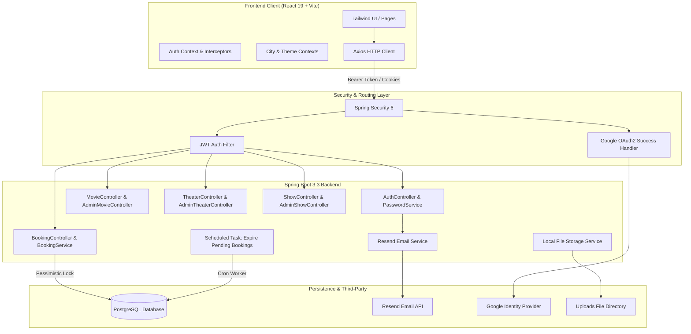
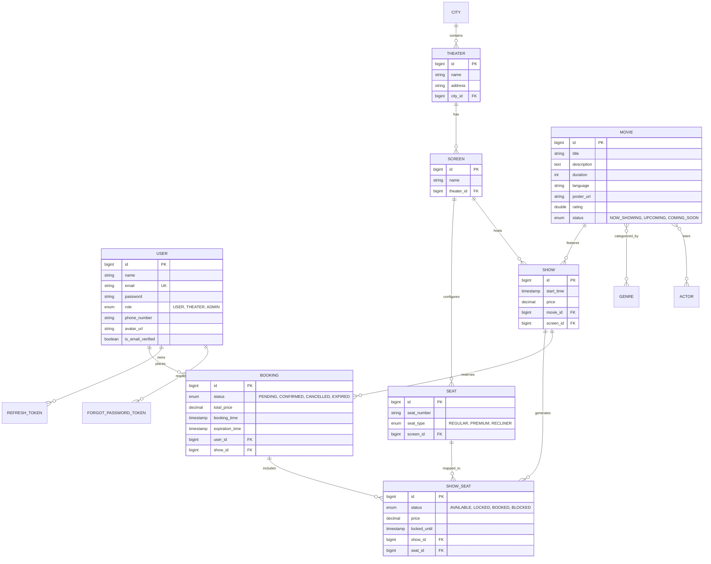
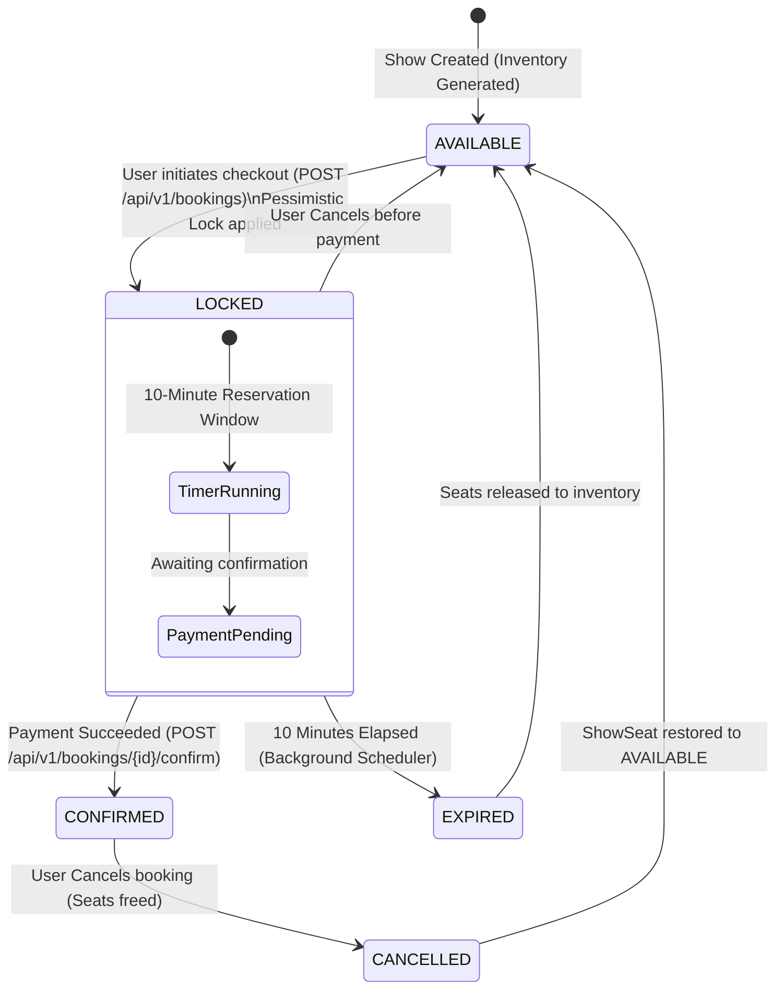

# 🎬 CineSeat — Full-Stack Movie Ticket Booking Platform

[](https://spring.io/projects/spring-boot)
[](https://www.oracle.com/java/)
[](https://react.dev/)
[](https://vitejs.dev/)
[](https://tailwindcss.com/)
[](https://www.postgresql.org/)
[](LICENSE)

**CineSeat** is an end-to-end, enterprise-ready cinema ticketing and management platform inspired by services like BookMyShow and Fandango. Built with **Spring Boot 3 (Java 21)**, **PostgreSQL**, and **React 19 + Vite**, CineSeat delivers a seamless movie discovery and reservation experience, complete with high-concurrency seat locking, automated inventory expiration, dual-role management portals, and modern authentication.

---

## 📑 Table of Contents

- [Key Features](#-key-features)
- [System Architecture](#-system-architecture)
- [Entity-Relationship Diagram](#-entity-relationship-diagram)
- [Booking Lifecycle & Concurrency Engine](#-booking-lifecycle--concurrency-engine)
- [Technology Stack](#-technology-stack)
- [Project Structure](#-project-structure)
- [API Reference](#-api-reference)
- [Security & Authentication](#-security--authentication)
- [Getting Started](#-getting-started)
  - [Prerequisites](#prerequisites)
  - [1. Database Setup](#1-database-setup)
  - [2. Backend Setup](#2-backend-setup)
  - [3. Frontend Setup](#3-frontend-setup)
- [Configuration & Environment Variables](#-configuration--environment-variables)
- [API Documentation (Swagger)](#-api-documentation-swagger)
- [Roadmap & Future Enhancements](#-roadmap--future-enhancements)

---

## ✨ Key Features

### 🍿 Customer & Discovery Experience
- **City-Aware Geolocation**: Select city once, and browse localized theaters, movies, and schedules.
- **Dynamic Catalog Filtering**: Search and filter movies by city, language, genre, and show status (`NOW_SHOWING`, `UPCOMING`, `COMING_SOON`).
- **Interactive Seat Layout**: Visual auditorium grid mapping regular, premium, and recliner seats with real-time status indicators (Available, Locked, Booked).
- **Cart & Dynamic Pricing**: Select up to 6 seats with real-time tier pricing calculation.
- **Digital Ticketing & QR Pass**: Access past and active bookings, review order summaries, and view digital ticket QR verification tokens.
- **Responsive Theme Support**: Built-in Dark / Light mode switching powered by Tailwind CSS.

### ⚡ Concurrency & Booking Engine
- **Pessimistic Seat Locking**: Database-level `PESSIMISTIC_WRITE` locks prevent race conditions and double-booking during checkout.
- **10-Minute Cart Hold**: Seats transition to `LOCKED` with an active expiration window.
- **Automated Seat Reclamation**: A Spring `@Scheduled` worker scans every 60 seconds to cancel expired pending reservations and free locked seats back to `AVAILABLE`.
- **Booking Lifecycle Management**: Clean state transitions across `PENDING`, `CONFIRMED`, `CANCELLED`, and `EXPIRED`.

### 🛡️ Partner & Admin Portal
- **Role-Based Access Control (RBAC)**: Distinct permissions for `USER`, `THEATER` (partners), and `ADMIN` roles.
- **Movie Catalog Management**: Add, update, and manage posters, trailers, descriptions, genres, and cast details.
- **Theater & Screen Builder**: Register cinema venues, configure multiple screens/auditoriums, and generate custom physical seat layouts (rows, columns, aisle spacing).
- **Show Scheduler**: Schedule shows with movie pairing, screen assignment, start times, and pricing.
- **User Role Administration**: Elevate users to Theater Partner or Administrator privileges.

---

## 🏛️ System Architecture



---

## 📊 Entity-Relationship Diagram



---

## 🔄 Booking Lifecycle & Concurrency Engine

CineSeat prevents double-booking using a two-phase reservation pipeline with pessimistic database locks:



1. **Locking Phase**: When a user selects seats and clicks *Proceed*, the backend executes `findByIdsWithPessimisticWriteLock(...)` inside a `@Transactional` boundary.
2. **Hold Timer**: Selected `ShowSeat` entities transition to `LOCKED`, and a `Booking` is created with status `PENDING` and `expirationTime = NOW() + 10 mins`.
3. **Confirmation**: Upon successful payment confirmation, status transitions to `CONFIRMED` and seats transition to `BOOKED`.
4. **Reclamation**: If payment is not completed within 10 minutes, the `@Scheduled(fixedRate = 60000)` worker identifies all expired pending bookings, marks them `EXPIRED`, and resets seats back to `AVAILABLE`.

---

## 💻 Technology Stack

### Backend
- **Core Platform**: Java 21, Spring Boot 3.3.5
- **Persistence**: Spring Data JPA, Hibernate, PostgreSQL
- **Security**: Spring Security 6, JJWT 0.12.5 (Access + Refresh tokens), OAuth2 Client (Google)
- **Email Service**: Resend Java SDK
- **Documentation**: SpringDoc OpenAPI 2.6.0 (Swagger UI)
- **Utilities**: Project Lombok, Jakarta Bean Validation

### Frontend
- **Framework**: React 19, Vite 7
- **Styling**: Tailwind CSS v4, `@tailwindcss/vite`
- **Routing**: React Router DOM v7
- **HTTP Client**: Axios with automated token refresh interceptors
- **Authentication**: JWT Decode, LocalStorage token management, OAuth redirect handling

---

## 📁 Project Structure

```text
CineSeat/
├── Backend/
│   ├── src/main/java/com/cineseat/
│   │   ├── actor/               # Actor entity and repositories
│   │   ├── auth/                # Auth controller, tokens, refresh token, password reset
│   │   │   └── password/        # Forgot/reset password logic
│   │   ├── booking/             # Booking controller, service, repositories, models
│   │   ├── city/                # Public and Admin city controllers, services
│   │   ├── config/              # OpenAPI, Web, and Application configuration
│   │   ├── email/               # Resend transactional email integration
│   │   ├── exception/           # Global exception handler and custom exceptions
│   │   ├── genre/               # Movie genre domain
│   │   ├── movie/               # Public and Admin movie controllers, specifications
│   │   ├── screen/              # Admin screen configuration and seat layouts
│   │   ├── seat/                # Physical seats and ShowSeat inventory with locking
│   │   ├── security/            # JWT filter, OAuth2 handler, Spring Security config
│   │   ├── service/             # Local file upload service
│   │   ├── show/                # Public and Admin show scheduling controllers
│   │   ├── theater/             # Public and Admin theater controllers
│   │   └── user/                # User profile and admin user role management
│   ├── src/main/resources/
│   │   └── application.properties # Spring configuration (DB, JWT, Resend, OAuth)
│   ├── uploads/                 # Local directory for user profile avatars
│   └── pom.xml                  # Maven dependencies & build configuration
│
├── Frontend/
│   ├── src/
│   │   ├── assets/              # Static icons and default avatars
│   │   ├── components/
│   │   │   ├── common/          # Hero, MovieSection, CitySelectionModal
│   │   │   ├── layout/          # Navbar, Footer, App Layout, AdminLayout
│   │   │   └── movie/           # MovieCard component
│   │   ├── context/             # AuthContext, ThemeContext, CityContext
│   │   ├── pages/
│   │   │   ├── admin/           # AdminDashboard, Movies, Theaters, Shows, Users
│   │   │   ├── Home.jsx         # Landing page with trending movies & hero carousel
│   │   │   ├── MovieDetails.jsx # Movie info, trailer, cast, and booking CTA
│   │   │   ├── TheaterListing.jsx # Shows listing grouped by theater
│   │   │   ├── SeatSelection.jsx  # Interactive auditorium seat map
│   │   │   ├── BookingSuccess.jsx # Confirmation and QR ticket preview
│   │   │   ├── UserBookings.jsx   # Booking history and ticket cancellation
│   │   │   ├── Profile.jsx      # User profile details and avatar upload
│   │   │   ├── SearchPage.jsx   # Multi-filter movie and theater search
│   │   │   ├── Login.jsx        # Credentials login & Google OAuth
│   │   │   └── Signup.jsx       # Registration form
│   │   └── services/
│   │       └── api.js           # Axios instance with interceptors and API wrappers
│   ├── package.json             # NPM dependencies & scripts
│   ├── vite.config.js           # Vite and Tailwind configuration
│   └── tailwind.config.js       # Tailwind theme setup
```

---

## 📡 API Reference

All backend endpoints are prefixed with `/api/v1`.

### 🔑 Authentication (`/api/v1/auth`)
| Method | Endpoint | Description | Access |
|---|---|---|---|
| `POST` | `/register` | Register new user account (`USER` or `THEATER`) | Public |
| `POST` | `/login` | Authenticate with email & password, return JWT | Public |
| `POST` | `/refresh-token` | Obtain new access token via refresh token cookie | Public |
| `POST` | `/logout` | Revoke user refresh token | Public |
| `POST` | `/verify-email` | Verify email token | Public |
| `POST` | `/password/forgot` | Trigger password reset email via Resend | Public |
| `POST` | `/password/reset` | Set new password with reset token | Public |

### 👤 User Profile (`/api/v1/users/me`)
| Method | Endpoint | Description | Access |
|---|---|---|---|
| `GET` | `/` | Get profile of currently authenticated user | Authenticated |
| `PATCH` | `/` | Update name and phone number | Authenticated |
| `POST` | `/avatar` | Upload profile image (multipart/form-data) | Authenticated |

### 🏙️ Cities (`/api/v1/cities`)
| Method | Endpoint | Description | Access |
|---|---|---|---|
| `GET` | `/` | List all active cities (supports name filter) | Public |
| `GET` | `/{id}` | Retrieve city details by ID | Public |

### 🎥 Movies (`/api/v1/movies`)
| Method | Endpoint | Description | Access |
|---|---|---|---|
| `GET` | `/` | Filter movies (by `cityId`, `genre`, `language`, `status`, pagination) | Public |
| `GET` | `/{id}` | Get complete movie details | Public |
| `GET` | `/trending` | List trending movies | Public |
| `GET` | `/{id}/cast` | List actors and cast members | Public |
| `GET` | `/{id}/languages` | Available languages for a movie | Public |

### 🎭 Theaters & Screens (`/api/v1/theaters`)
| Method | Endpoint | Description | Access |
|---|---|---|---|
| `GET` | `/` | List theaters (filter by `cityId`, `movieId`, `date`) | Public |
| `GET` | `/{id}` | Get theater details and amenities | Public |
| `GET` | `/{id}/shows` | Get upcoming shows at a specific theater | Public |

### 🎟️ Shows & Seats (`/api/v1/shows`)
| Method | Endpoint | Description | Access |
|---|---|---|---|
| `GET` | `/` | Find shows by `movieId`, `cityId`, and `date` | Public |
| `GET` | `/{id}` | Get detailed show information | Public |
| `GET` | `/{id}/seats` | Real-time seat layout with status (`AVAILABLE`, `LOCKED`, `BOOKED`) | Public |

### 💳 Bookings (`/api/v1/bookings`)
| Method | Endpoint | Description | Access |
|---|---|---|---|
| `POST` | `/` | Lock selected seats and initiate booking (`PENDING`) | Authenticated |
| `POST` | `/{id}/confirm` | Confirm payment and finalize ticket (`CONFIRMED`) | Authenticated |
| `GET` | `/{id}` | Retrieve booking status and details | Authenticated |
| `GET` | `/me` | List booking history for current user | Authenticated |
| `PATCH` | `/{id}/cancel` | Cancel booking and release seats | Authenticated |
| `GET` | `/{id}/ticket` | Generate and fetch ticket verification payload | Authenticated |

### ⚙️ Admin & Partner Endpoints (`/api/v1/admin`)
| Method | Endpoint | Description | Required Role |
|---|---|---|---|
| `POST` | `/cities` | Register a new city | `ADMIN` / `THEATER` |
| `POST` | `/movies` | Create a movie record | `ADMIN` / `THEATER` |
| `PUT` | `/movies/{id}` | Update movie metadata | `ADMIN` / `THEATER` |
| `DELETE` | `/movies/{id}` | Delete a movie | `ADMIN` / `THEATER` |
| `POST` | `/theaters` | Create a theater | `ADMIN` / `THEATER` |
| `PUT` | `/theaters/{id}` | Update theater details | `ADMIN` / `THEATER` |
| `POST` | `/theaters/{id}/screens` | Add screen to theater | `ADMIN` / `THEATER` |
| `POST` | `/screens/{id}/seat-layout` | Configure physical seats (rows, count, types) | `ADMIN` / `THEATER` |
| `POST` | `/shows` | Create show and generate seat inventory | `ADMIN` / `THEATER` |
| `PUT` | `/shows/{id}` | Reschedule show or update pricing | `ADMIN` / `THEATER` |
| `DELETE` | `/shows/{id}` | Cancel/delete show | `ADMIN` / `THEATER` |
| `GET` | `/users` | List all users | `ADMIN` |
| `PATCH` | `/users/{id}/role` | Update user role (`USER`, `THEATER`, `ADMIN`) | `ADMIN` |

---

## 🔒 Security & Authentication

CineSeat enforces stateless, token-based authentication using **Spring Security**:

1. **Short-Lived Access Tokens**: Signed JWTs with a 10-minute expiry sent in the `Authorization: Bearer <token>` header.
2. **Secure Refresh Tokens**: Long-lived tokens (10 days) stored securely in the database with rotation support.
3. **Transparent Frontend Refresh**: Axios response interceptors catch `401 Unauthorized` responses and silently hit `/api/v1/auth/refresh-token` before re-executing failed requests.
4. **Google OAuth2 Login**: Users can authenticate via Google. On successful login, `OAuth2LoginSuccessHandler` synchronizes the user account and redirects back to `/oauth/callback` with tokens.
5. **Role-Based Guards**: Protected UI routes and controller endpoints use `@PreAuthorize("hasRole('ADMIN')")` or `@PreAuthorize("hasAnyRole('ADMIN', 'THEATER')")`.

---

## 🚀 Getting Started

### Prerequisites
Make sure you have installed:
- **Java 21 JDK**
- **Maven 3.9+** (or use included `./mvnw`)
- **Node.js 18+ & npm**
- **PostgreSQL 15+**

---

### 1. Database Setup

Create a PostgreSQL database named `cine_seat`:

```sql
CREATE DATABASE cine_seat;
```

---

### 2. Backend Setup

1. **Navigate to the backend directory**:
   ```bash
   cd Backend
   ```

2. **Configure database credentials & keys**:
   Edit `src/main/resources/application.properties` or set environment variables:
   ```properties
   spring.datasource.url=jdbc:postgresql://localhost:5432/cine_seat
   spring.datasource.username=your_postgres_username
   spring.datasource.password=your_postgres_password
   
   jwt.secret=your_strong_jwt_secret_at_least_256_bits_long
   jwt.expirationMs=600000
   jwt.refreshExpirationMs=864000000
   
   frontend.url=http://localhost:5173
   app.upload.dir=/path/to/CineSeat/Backend/uploads
   app.upload.url-base=http://localhost:8080/uploads
   
   resend.api.key=your_resend_api_key
   
   # Optional Google OAuth2
   spring.security.oauth2.client.registration.google.client-id=your_google_client_id
   spring.security.oauth2.client.registration.google.client-secret=your_google_client_secret
   ```

3. **Build and run the Spring Boot application**:
   ```bash
   ./mvnw clean spring-boot:run
   ```
   The backend will start at `http://localhost:8080`.

---

### 3. Frontend Setup

1. **Navigate to the frontend directory**:
   ```bash
   cd Frontend
   ```

2. **Install dependencies**:
   ```bash
   npm install
   ```

3. **Configure environment (optional)**:
   Create a `.env` file in `Frontend/` if your backend is hosted on a custom port:
   ```env
   VITE_API_URL=http://localhost:8080
   ```

4. **Start the Vite development server**:
   ```bash
   npm run dev
   ```
   The application will be accessible at `http://localhost:5173`.

---

## ⚙️ Configuration & Environment Variables

| Variable | Description | Default / Example |
|---|---|---|
| `spring.datasource.url` | PostgreSQL JDBC connection URL | `jdbc:postgresql://localhost:5432/cine_seat` |
| `spring.datasource.username` | Database user | `postgres` |
| `spring.datasource.password` | Database password | `admin` |
| `jwt.secret` | HMAC secret for signing JWTs | Base64 or 256-bit string |
| `jwt.expirationMs` | Access token lifespan (ms) | `600000` (10 minutes) |
| `jwt.refreshExpirationMs` | Refresh token lifespan (ms) | `864000000` (10 days) |
| `frontend.url` | Frontend origin for CORS and OAuth redirects | `http://localhost:5173` |
| `app.upload.dir` | Filesystem path for uploaded images | `/path/to/CineSeat/Backend/uploads` |
| `app.upload.url-base` | Public URL prefix for uploaded media | `http://localhost:8080/uploads` |
| `resend.api.key` | Resend API key for verification and reset emails | `re_...` |
| `VITE_API_URL` | Frontend API target | `http://localhost:8080` |

---

## 📖 API Documentation (Swagger)

Once the backend is running, access interactive OpenAPI / Swagger documentation directly in your browser:

- **Swagger UI**: [http://localhost:8080/swagger-ui/index.html](http://localhost:8080/swagger-ui/index.html)
- **OpenAPI JSON**: [http://localhost:8080/v3/api-docs](http://localhost:8080/v3/api-docs)

---

## 🗺️ Roadmap & Future Enhancements

- [ ] **Payment Gateway Integration**: Webhook handling for Razorpay / Stripe checkout events.
- [ ] **Seat Lock WebSockets**: Live broadcast of locked seats across connected clients using STOMP / WebSocket.
- [ ] **Coupon & Loyalty System**: Promotional codes, seasonal discounts, and user reward points.
- [ ] **Email Ticket PDF Delivery**: Automated delivery of PDF tickets with scannable QR codes upon booking confirmation.
- [ ] **User Reviews & Ratings**: Community movie reviews with moderation filters.

---

## 📄 License

This project is licensed under the MIT License — see the [LICENSE](LICENSE) file for details.
